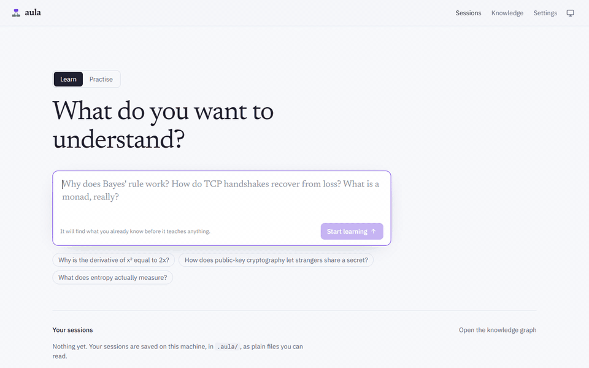
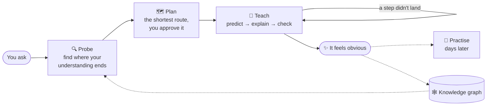
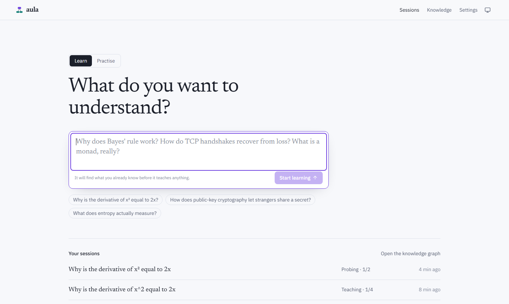

<p align="center">
  <picture>
    <source media="(prefers-color-scheme: dark)" srcset="docs/assets/banner-dark.svg">
    <source media="(prefers-color-scheme: light)" srcset="docs/assets/banner-light.svg">
    
  </picture>
</p>

<h3 align="center">Understand it until it feels obvious.</h3>

<p align="center">
  An AI teacher that finds out what you already know, plans the shortest route
  to what you want to understand, and checks every step lands.<br>
  Local-first · open source · bring your own model.
</p>

<p align="center">
  <a href="https://github.com/NouhKhouyi/aula/actions/workflows/ci.yml"></a>
  <a href="LICENSE"></a>
  <a href="https://nouhkhouyi.github.io/aula/"></a>
</p>

<p align="center">
  <a href="#-try-it-in-a-minute"><b>Try it</b></a> ·
  <a href="#-how-a-lesson-works"><b>How it works</b></a> ·
  <a href="docs/app.md"><b>Guide</b></a> ·
  <a href="https://nouhkhouyi.github.io/aula/"><b>Website</b></a>
</p>

<p align="center">
  <picture>
    <source media="(prefers-color-scheme: dark)" srcset="docs/assets/demo-dark.gif">
    
  </picture>
  <br>
  <sub>A real session in demo mode, sped up: ask, get probed, approve the plan,
  learn step by step.</sub>
</p>

## 💡 Why aula?

Ask a chatbot to explain something and you get an explanation written for
nobody in particular. aula works the other way round.

| | Asking a chatbot | aula |
|---|---|---|
| **Starts from** | The topic | **What you already know** — it probes first |
| **Order** | Whatever the answer happens to be | **A plan you approve**: foundations first, your goal last |
| **Pace** | One long answer | **One reasoning step at a time**, each one checked |
| **Your mistakes** | Mostly invisible | **Found and repaired** before anything is built on them |
| **Next week** | Starts from zero | **Remembers** — a knowledge graph across sessions |
| **Your notes** | Lost in the chat | **Saved to Obsidian** with real math and diagrams |

## 🧭 How a lesson works



1. **Probe.** A few questions that escalate until something breaks. Missing is
   the point — that's how it finds your edge. *I don't know* is always a good
   answer.
2. **Plan.** A dependency map: things you can accept at face value at the
   bottom, your goal at the top. Read the foundations; approve it or send it
   back.
3. **Teach.** One small step at a time. You predict, it explains, it checks.
   If a step doesn't land, it gets fixed right there.
4. **Practise.** Later, problems that never name the idea they need — so it
   has to come to mind on its own.

> [!TIP]
> **Think out loud.** Every question has a confidence slider and a box for your
> reasoning. A confident wrong answer tells the teacher far more than a lucky
> right one.

## 📸 A look around

<table>
  <tr>
    <td colspan="2"></td>
  </tr>
  <tr>
    <td colspan="2" align="center"><sub><b>Start here.</b> One question,
      learn or practise.</sub></td>
  </tr>
  <tr>
    <td width="50%"></td>
    <td width="50%"></td>
  </tr>
  <tr>
    <td align="center"><sub><b>Practice</b> responds to your reasoning, not
      just your answer.</sub></td>
    <td align="center"><sub><b>The knowledge graph</b> carries what you
      learned across sessions.</sub></td>
  </tr>
</table>

## 🚀 Try it in a minute

You need [Node.js](https://nodejs.org) 20.9 or newer.

```bash
git clone https://github.com/NouhKhouyi/aula
cd aula
npm install
npm run dev
```

Open <http://localhost:3000>, go to **Settings**, and pick a teacher:

| Option | You need | Good for |
|---|---|---|
| 🎓 **Claude** *(recommended)* | An [Anthropic API key](https://console.anthropic.com) | The best lessons, with facts checked on the web |
| 🔌 **OpenAI-compatible** | A key and a model id — or nothing, for a local model | OpenAI, OpenRouter, DeepSeek, Ollama, LM Studio |
| 🧪 **Demo** | Nothing | Seeing the whole loop in two minutes, for free |

Then ask it something you've always half-understood.

<details>
<summary><b>Want to look around with realistic data first?</b></summary>

```bash
AULA_DATA_DIR=/tmp/aula-showcase npm run showcase
AULA_DATA_DIR=/tmp/aula-showcase npm run dev
```

That writes a lesson in progress, a practice round and a knowledge graph into
a scratch folder, without touching your own record.

</details>

## ✨ What's inside

- **🎯 Real quizzes** — shuffled options, *I don't know*, confidence and a
  thinking box; they show you the reasoning after you answer.
- **🗺️ A live plan map** — foundations at the bottom, the goal on top, the
  current step highlighted as you go.
- **🕸️ A knowledge graph** — every session adds what it established; new
  lessons read it, so they don't start from scratch.
- **📚 Your course material** — attach notes or a syllabus from `Material/` to
  set the scope and notation.
- **🔎 Fact-checking** — with Claude, the teacher verifies on the web anything
  it's unsure of, and shows what it checked.
- **📝 Obsidian export** — every lesson as a note with callouts, LaTeX and
  Mermaid diagrams.
- **🌗 Light and dark**, keyboard shortcuts, and it works on a phone.

## 🔒 Yours, on your machine

- **No account, no subscription, no telemetry.** You pay your model provider
  directly; aula adds nothing.
- **Plain files.** Sessions, the graph and settings live in `.aula/` as JSON
  you can read, back up or delete. Keys never reach the browser.
- **A method you can read.** How it teaches is plain prose in
  [`src/lib/core/prompts.ts`](src/lib/core/prompts.ts). Change the prose,
  change the teacher.

<details>
<summary><b>💻 Prefer studying in a terminal agent?</b></summary>

aula started as an Obsidian vault for terminal agents, and that still works.
[`AGENTS.md`](AGENTS.md) carries the whole method for Claude Code, Codex,
Cursor, [pi](https://github.com/earendil-works/pi) and anything else that
reads it: the agent teaches in the terminal and writes the lesson into
`Lessons/` for you to read in Obsidian. See [the terminal guide](docs/guide.md)
and [agents](docs/agents.md).

</details>

<details>
<summary><b>🛠️ For developers</b></summary>

```bash
npm run dev          # http://localhost:3000, with hot reload
npm test             # deterministic: no model, no network, no key
npm run check        # lint, typecheck, formatting and tests
```

```text
aula/
├── src/
│   ├── app/              # pages and API routes (Next.js)
│   ├── components/       # lesson, quiz cards, plan map, graph
│   └── lib/
│       ├── core/         # pure logic: tools, prompts, plan, quiz, graph
│       ├── server/       # agent loop, providers, file store
│       └── client/       # browser-side helpers
├── tests/                # Vitest
├── site/                 # the website
├── AGENTS.md             # the method, for terminal agents
└── docs/                 # guides and design notes
```

Read the [architecture](docs/architecture.md), the
[data format](docs/data-format.md) and the
[development guide](docs/development.md).

</details>

## 📖 Docs

| | |
|---|---|
| [**Using the app**](docs/app.md) | Sessions, quizzes, plans, practice, the graph, export. |
| [**Your half of the system**](docs/pedagogy.md) | What you have to do for any of this to work. Short. |
| [**FAQ**](docs/faq.md) | Which model? What does it cost? Local models? |
| [**Architecture**](docs/architecture.md) | The agent loop, providers, tools and data model. |
| [**Terminal guide**](docs/guide.md) | The vault workflow with pi, Claude Code or Codex. |

## 🤝 Contributing

Contributions are welcome — and the most useful one is telling me **where a
lesson went wrong for you**. Open a
[session report](https://github.com/NouhKhouyi/aula/issues/new?template=session-report.yml),
or read [CONTRIBUTING.md](CONTRIBUTING.md) to send code.

## 🙏 Credits

The teaching method — probe, plan, teach; unconditional truths first; "how
could I have discovered this myself?" — comes from Amos Blomqvist's
[`learn`](https://github.com/amosblomqvist/learn), and the app's shape is
inspired by his [LearnHarness](https://github.com/amosblomqvist/learnharness).
aula is an independent implementation; no code is shared.

<p align="center"><sub>MIT licensed · made by
<a href="https://github.com/NouhKhouyi">Nouh Khouyi</a></sub></p>
