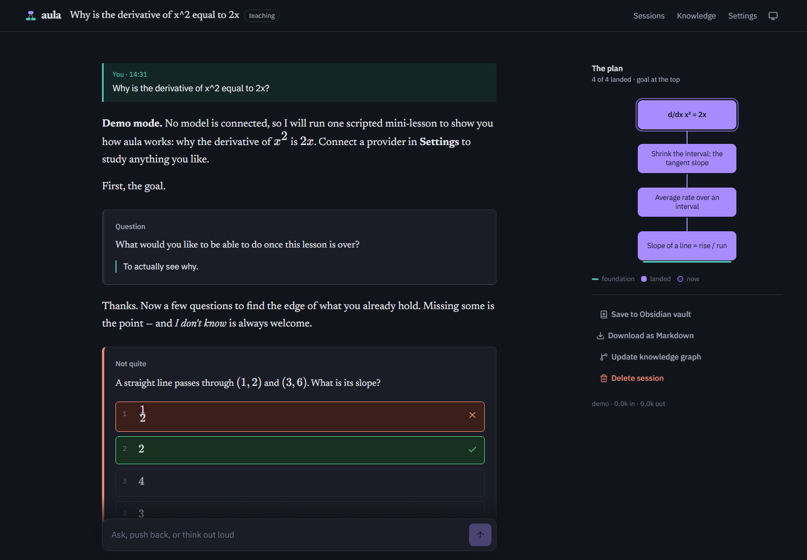
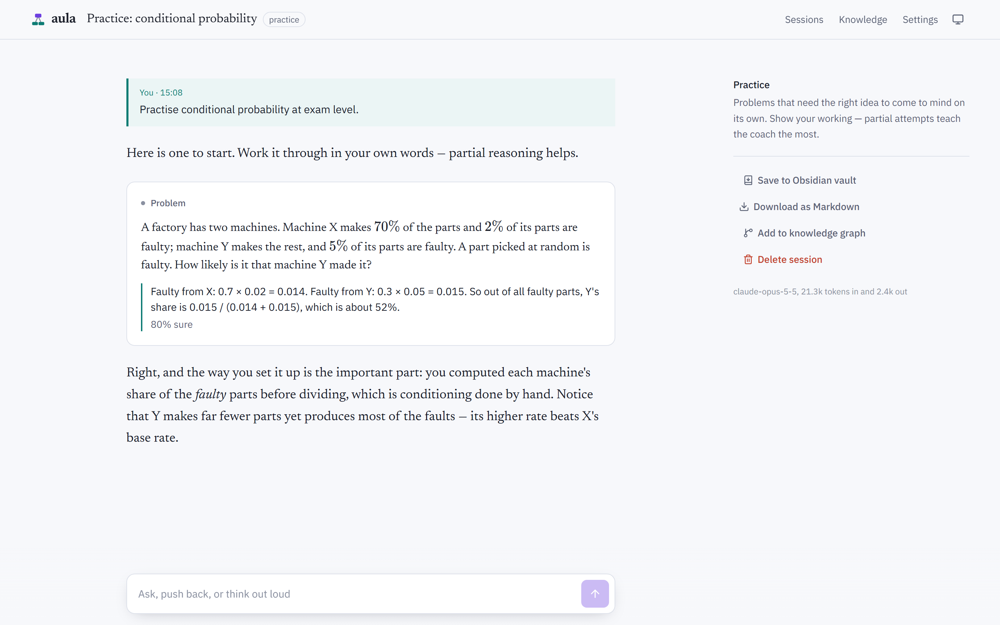
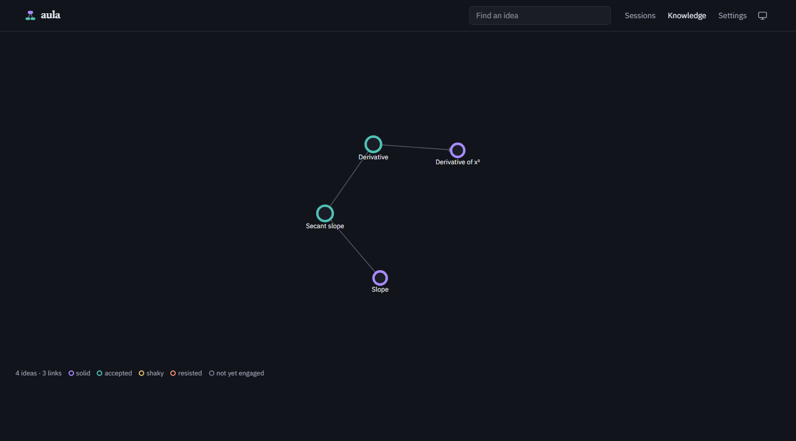

<p align="center">
  <picture>
    <source media="(prefers-color-scheme: dark)" srcset="docs/assets/banner-dark.svg">
    <source media="(prefers-color-scheme: light)" srcset="docs/assets/banner-light.svg">
    
  </picture>
</p>

<p align="center"><strong>An agent harness for learning. Local-first, open source,
bring your own model.</strong></p>

<p align="center">
  <a href="#quick-start">Quick start</a> ·
  <a href="#how-it-works">How it works</a> ·
  <a href="docs/app.md">Using the app</a> ·
  <a href="docs/architecture.md">Architecture</a> ·
  <a href="https://github.com/NouhKhouyi/aula/issues">Issues</a>
</p>

<p align="center">
  <a href="https://github.com/NouhKhouyi/aula/actions/workflows/ci.yml"></a>
  <a href="LICENSE"></a>
</p>

aula uses an AI teacher to take you from what you understand now to what you
want to understand — one reasoning step at a time. It does not start by
explaining. It starts by finding out where your understanding ends, plans the
shortest route from there to your goal, and checks every step lands before it
builds on it.

Everything you learn accumulates in a **knowledge graph** that the next session
reads, and every lesson can be saved as a note in your **Obsidian vault**, with
real typeset math and drawn diagrams.

<picture>
  <source media="(prefers-color-scheme: dark)" srcset="docs/assets/lesson-dark.png">
  
</picture>

## How it works

1. **Probe.** Before teaching anything, the teacher finds the edge of your
   understanding on each strand the goal depends on — bounded on both sides:
   something you get right, and something you don't. It also makes your goal
   concrete. Missing questions is the point, and *I don't know* is always a
   good answer.
2. **Plan.** It searches for the minimal route from what you hold to your goal
   and shows it as a dependency map: unconditional truths at the bottom, your
   goal at the top. You approve it, or send it back.
3. **Teach.** One reasoning step at a time. You predict, it explains, it
   checks. A step that didn't land is repaired before anything is built on it.
   The aim is for the goal to feel *obviously true*, not merely familiar.
4. **Practise.** Separate sessions pose problems that never name the idea they
   need, so knowledge has to come to mind on its own. Hints respond to your
   actual reasoning.

**Think out loud.** Every question has a field for your reasoning and a
confidence slider. That is how the teacher sees *why* you answered, not just
whether you were right — a confident wrong answer is a misconception to evict,
not a gap to top up.

**Accuracy is non-negotiable.** With Claude, the teacher verifies anything it is
unsure of on the web before saying it, and shows you what it checked.

<table>
  <tr>
    <td width="50%"></td>
    <td width="50%"></td>
  </tr>
  <tr>
    <td>Practice responds to your reasoning, not just your answer.</td>
    <td>The knowledge graph carries what you learned across sessions.</td>
  </tr>
</table>

## Quick start

You need [Node.js](https://nodejs.org) 20.9 or newer.

```bash
git clone https://github.com/NouhKhouyi/aula
cd aula
npm install
npm run build && npm start      # or: npm run dev
```

Open <http://localhost:3000>. Then, in **Settings**, either:

- add an **Anthropic API key** — the recommended path, with web verification;
- point it at any **OpenAI-compatible** endpoint (OpenAI, OpenRouter, DeepSeek,
  a local Ollama or LM Studio); or
- choose **Demo** to walk through a scripted lesson with no key at all.

Ask it something you want to understand, and answer honestly.

## Knowledge that carries forward

After a session, choose **Add to knowledge graph**. The session is read for the
propositions it established and the reasoning steps that connect them, each
linked back to where it came up and to how well you held it at the time.

The next session on a related topic starts with the relevant part of the graph
in front of the teacher, so it can probe precisely instead of starting from
scratch. The graph stores ideas and their connections — evidence, not grades.

## Your vault, your keys, your data

- **Local storage.** Sessions, the graph, settings and keys live in `.aula/`, as
  plain JSON you can read, back up and diff. Nothing is sent anywhere except to
  the model provider you configure.
- **Your keys.** You pay your provider directly. Keys stay on the server side of
  the app and are never sent to the browser. The session panel shows token use.
- **Obsidian-native.** **Save to Obsidian vault** writes the lesson into
  `Lessons/` (or any folder you choose) as callouts with LaTeX and Mermaid —
  the same format the terminal workflow uses.
- **Inspectable.** The teacher's whole method is a readable prompt in
  [`src/lib/core/prompts.ts`](src/lib/core/prompts.ts). Change how it teaches by
  editing prose.

## Prefer a terminal agent?

aula started as an Obsidian vault for terminal agents, and that still works.
[`AGENTS.md`](AGENTS.md) carries the full pedagogy for Claude Code, Codex,
Cursor, [pi](https://github.com/earendil-works/pi) and anything else that reads
it: the agent teaches in the terminal and writes the lesson into `Lessons/` for
you to read in Obsidian. See [the terminal guide](docs/guide.md) and
[agents](docs/agents.md).

## Repository layout

```text
aula/
├── src/
│   ├── app/              # Next.js pages and API routes
│   ├── components/       # the interface: lesson, quiz, plan map, graph
│   └── lib/
│       ├── core/         # pure logic: tools, prompts, plan, quiz, graph, export
│       ├── server/       # agent loop, providers, file store
│       └── client/       # browser-side API helpers
├── tests/                # vitest — no network, no API key
├── AGENTS.md             # the pedagogy, for terminal agents
├── Lessons/  Material/   # your vault (git-ignored)
├── docs/                 # guides and design notes
└── scripts/              # vault setup for the terminal workflow
```

## Development

```bash
npm run dev          # http://localhost:3000, with hot reload
npm test             # deterministic: no LLM, no network
npm run check        # lint, typecheck, formatting and tests
AULA_DATA_DIR=/tmp/aula-showcase npm run showcase   # sample data to explore
```

See the [development guide](docs/development.md) and the
[architecture](docs/architecture.md). Contributions are welcome — especially
reports of where the teaching broke down for you. See
[CONTRIBUTING.md](CONTRIBUTING.md).

## Documentation

| | |
|---|---|
| [**Using the app**](docs/app.md) | Sessions, quizzes, plans, practice, the graph, export. |
| [**Your half of the system**](docs/pedagogy.md) | What you have to do for any of this to work. |
| [**Architecture**](docs/architecture.md) | The agent loop, providers, tools and data model. |
| [**Data format**](docs/data-format.md) | What is in `.aula/`, file by file. |
| [**Development**](docs/development.md) | Running, testing, adding a provider or a tool. |
| [**Terminal guide**](docs/guide.md) | The vault workflow with pi, Claude Code or Codex. |
| [**FAQ**](docs/faq.md) | Including "why not just ask ChatGPT?" |

## Credits

The teaching method — probe, plan, teach; unconditional truths first; "how could
I have discovered this myself?" — comes from Amos Blomqvist's
[`learn`](https://github.com/amosblomqvist/learn), and the app's shape is
inspired by his [LearnHarness](https://github.com/amosblomqvist/learnharness).
aula is an independent implementation; no code is shared. Lessons render in
[Obsidian](https://obsidian.md), math with [KaTeX](https://katex.org) and
diagrams with [Mermaid](https://mermaid.js.org).

## License

[MIT](LICENSE).
