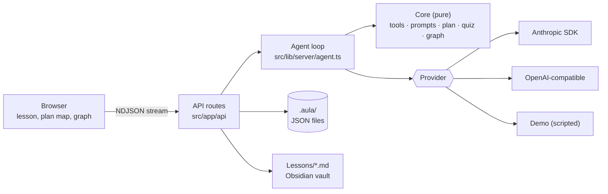
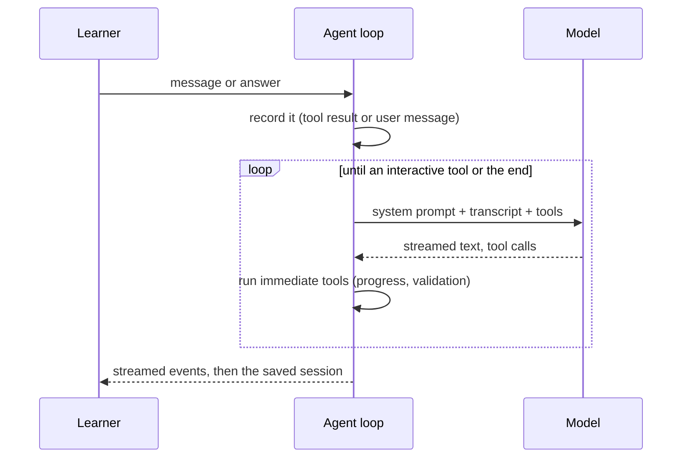

# Architecture

aula is a Next.js application that runs on your own machine. The browser talks
to local API routes; the routes run the teaching agent against the model
provider you configure and persist everything as plain files in `.aula/`.

## Layers

| Layer | Path | Depends on |
|---|---|---|
| **Core** | `src/lib/core/` | Nothing but `zod`. Pure functions, no I/O, runs in the browser and on the server. |
| **Server** | `src/lib/server/` | Core, Node's `fs`, the provider SDKs. |
| **Routes** | `src/app/api/` | Server. Thin: parse, lock, call, respond. |
| **Interface** | `src/components/`, `src/app/` | Core (for rendering decisions) and `src/lib/client/`. |

Keeping the core pure is what lets the browser and the server agree on things
without storing them — the most important example being quiz option order (see
[below](#quizzes-are-shuffled-deterministically)).

## The agent loop

A **turn** starts with something the learner did — a message, or an answer to
a pending question — and ends when the teacher asks the learner something or
finishes speaking.

Tools come in two kinds (`src/lib/core/tools.ts`):

| Tool | Kind | Effect |
|---|---|---|
| `quiz` | interactive | A graded question: probe, predict or check. |
| `ask` | interactive | An open question with no correct answer. |
| `propose_plan` | interactive | The dependency map, approved or sent back. |
| `pose_problem` | interactive | A practice problem with a committed model solution. |
| `set_progress` | immediate | Marks plan nodes as current or landed. |

An **interactive** call ends the turn: the session is saved with the call open,
and the next turn answers it. An **immediate** call is executed by the server and
the model continues in the same turn. Invalid input — a malformed quiz, a plan
with a cycle or an off-path node — is answered with an error the model can fix,
and never reaches the learner.

The loop is capped at eight model calls per turn, and a turn that stops on
`max_tokens` never runs a truncated tool call.

### Every call gets exactly one result

Providers require each tool call to be answered before the conversation moves
on. aula guarantees it: if the learner writes a message instead of answering,
the open calls are closed with a "skipped" result first. A test walks a whole
lesson and asserts the transcript stays replayable.

## The transcript

Messages are stored in a provider-neutral shape (`src/lib/core/types.ts`):
`user`, `assistant` (text, tool calls, web-search notes) and `tool` (results
with structured `details` for the interface). Each assistant message also keeps
the provider's **raw content**, which is replayed byte-for-byte to the same
provider — Claude's thinking blocks must be passed back unchanged. Raw content
never leaves the server.

## Providers

`src/lib/server/providers/` implements one interface: stream a turn, and
produce a JSON object that matches a schema (used for graph extraction).

- **Anthropic** uses the official SDK with the beta Messages surface: adaptive
  thinking and an `effort` level on current models, prompt caching on the
  stable system prompt, the server-side web search tool, and server-side
  refusal fallbacks (`fallbacks: "default"`) on the models that support them.
  A turn paused during a long search is resumed in place.
- **OpenAI-compatible** speaks chat completions with function calling, so it
  works with OpenAI, OpenRouter, DeepSeek, Groq, Ollama or LM Studio.
- **Demo** is a scripted teacher. It powers the keyless demo and lets the test
  suite drive the real agent loop with no network.

Errors are mapped to messages a learner can act on ("check the key in
Settings"), never raw stack traces.

## Quizzes are shuffled deterministically

The teacher writes one correct option and several distractors mutated from it.
The order on screen is a shuffle seeded by the tool-call id, computed by the
same pure function in the browser and on the server. Nothing has to be stored
for both to agree, grading always uses the order the learner saw, and the
Obsidian export records exactly what was on screen.

## The plan

`propose_plan` is validated before the learner ever sees it: ids are unique,
edges point at real nodes, the graph is acyclic, every root is marked as a
foundation, and every node leads to the goal. The map in the interface lays
nodes out by longest path from a root, so foundations are on the bottom row and
the goal is on top, and orders each row by its prerequisites' positions to
limit crossings.

## The knowledge graph

Extraction (`src/lib/server/extract.ts`) sends a plain-text rendering of the
session to the model with a strict schema, and merges the result
(`src/lib/core/graph.ts`):

- A proposition merges with an existing one only on an identical normalised
  statement. A duplicate is cheap to live with; a wrong merge corrupts the
  record.
- Each source records the session and the learner's understanding at the end of
  it, on a closed five-word scale.
- Chains are premises that jointly imply a conclusion. Chains that reference
  unknown or circular propositions are dropped.

At the start of a session, the propositions most related to the opening
message are added to the system prompt. The selection depends only on the
first message, so the prompt is identical for every turn and stays cacheable.

## Storage and concurrency

All writes go to a temporary file and are renamed into place, so a crash never
leaves a half-written record. Turns on the same session, and graph updates, are
serialised with an in-process lock. The session is saved after every message,
so a dropped connection loses nothing already said. See
[the data format](data-format.md).

## Security model

aula is a single-user app meant to run on `localhost`.

- API keys are read only on the server and are never included in responses.
- Session ids are validated before they become file names.
- Model output is rendered as Markdown with raw HTML disabled; Mermaid runs with
  `securityLevel: "strict"`; links open with `noopener`.
- There is no authentication. **Do not expose the server to a network you do
  not trust.**
